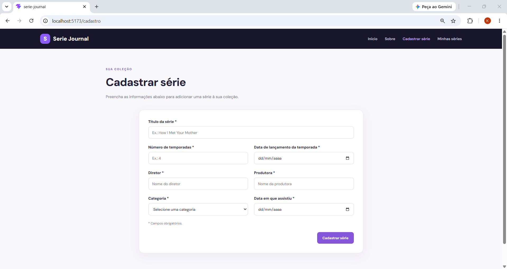
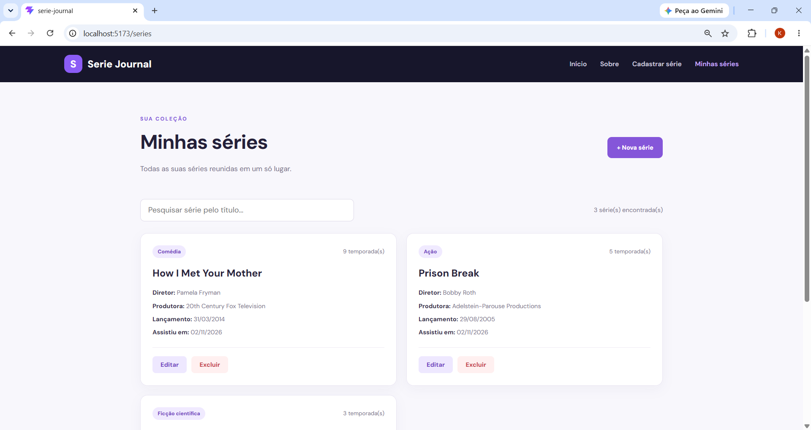
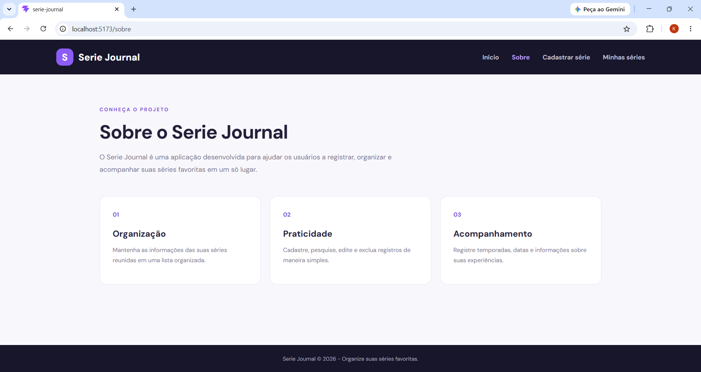

# Serie Journal

## Nome: Karolmara Paula Nunes

## Como executar o projeto

Para executar este projeto, é necessário ter o Node.js e o npm instalados no computador.

1. Abra o terminal e entre na pasta do projeto:

```bash
cd C:\Users\Karol\Desktop\serie-journal
```

2. Instale as dependências:

```bash
npm install
```

3. Inicie a aplicação:

```bash
npm run dev
```

4. Abra no navegador o endereço informado pelo Vite, normalmente:

```text
http://localhost:5173/
```

Para gerar a versão de produção:

```bash
npm run build
```

## Resultado esperado

O Serie Journal é uma aplicação web para organizar e acompanhar séries assistidas pelo usuário.

A aplicação possui página inicial, página informativa, página de cadastro e página de listagem.

As imagens abaixo demonstram as telas desenvolvidas:

**Página inicial**


**Página de cadastro**



**Página de listagem**



**Página Sobre**



## Introdução

O Serie Journal foi desenvolvido utilizando React e Vite, com o objetivo de permitir o cadastro e a organização de séries assistidas.

O usuário pode registrar informações como título, número de temporadas, data de lançamento, diretor, produtora, categoria e data em que assistiu à série.

A aplicação permite consultar, pesquisar, editar e excluir séries cadastradas.

Foi utilizado React Router para a navegação entre as páginas e localStorage para armazenar os dados no navegador, permitindo que permaneçam disponíveis após atualizar a página no mesmo navegador.

## Componentes

Os componentes estão organizados no diretório `./src/components`, com uma pasta específica para cada componente.

- **NavBar:**
  - Descrição: componente responsável pela barra de navegação da aplicação, permitindo o acesso às páginas disponíveis.

- **SerieForm:**
  - Descrição: componente responsável pelo formulário de cadastro e edição de séries.
  - Possui campos para preenchimento das informações, validação dos dados obrigatórios e feedback visual para o usuário.
  - Também verifica se a data em que o usuário assistiu à série não é anterior à data de lançamento informada.

- **SerieList:**
  - `props`:
    - `series`: lista de séries recebida da aplicação;
    - `onEditar`: função responsável por iniciar a edição de uma série;
    - `onExcluir`: função responsável por excluir uma série.
  - Descrição: componente responsável por apresentar as séries cadastradas, exibir suas informações e disponibilizar as funcionalidades de pesquisa, edição e exclusão.

## Páginas

As páginas estão organizadas no diretório `./src/pages`.

- **Home:** página inicial de apresentação da aplicação.
- **Sobre:** página com informações sobre o projeto.
- **Cadastro:** página que apresenta o formulário de cadastro e edição de séries.
- **Series:** página responsável pela listagem das séries cadastradas.

## Funcionalidades implementadas

- Cadastro de novas séries.
- Listagem das séries cadastradas e suas informações.
- Pesquisa de séries pelo título.
- Edição dos dados de uma série.
- Exclusão de séries com confirmação.
- Validação dos campos obrigatórios.
- Validação das datas informadas.
- Armazenamento dos dados no localStorage do navegador.

## Testes

Foram realizados testes manuais no navegador para verificar o funcionamento das principais funcionalidades:

- Cadastro de uma nova série.
- Edição de uma série cadastrada.
- Exclusão de uma série.
- Pesquisa de séries pelo título.
- Persistência dos dados após atualizar a página.

Não foi configurada uma suíte de testes automatizados nesta fase.

## Conclusão

O projeto Serie Journal foi desenvolvido para colocar em prática os conceitos fundamentais de React, incluindo componentização, propriedades (props), gerenciamento de estado, formulários, validação de dados e navegação entre páginas.

A aplicação atende às funcionalidades propostas para a primeira fase do projeto.
